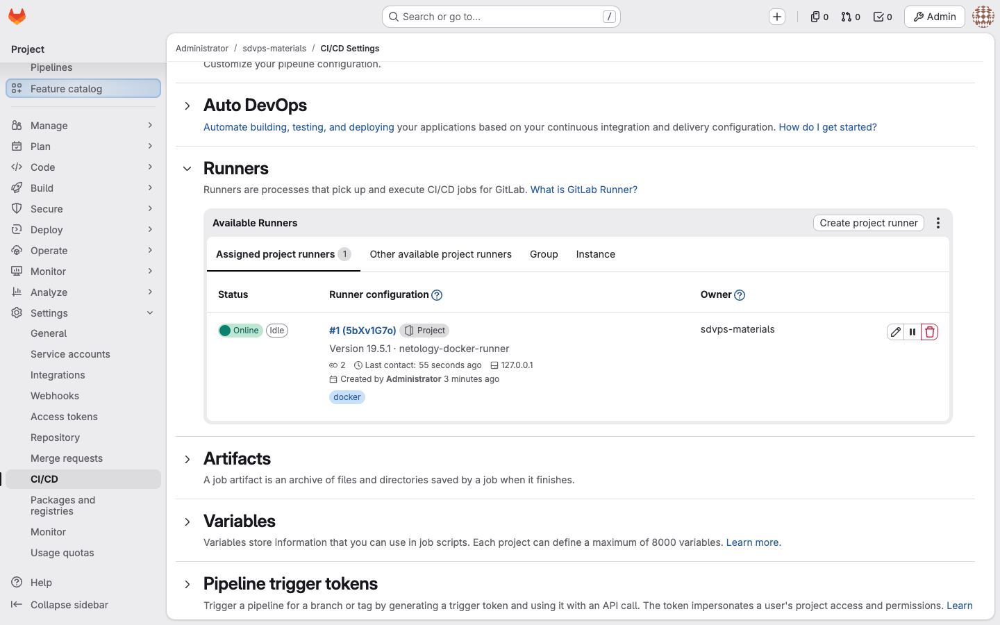
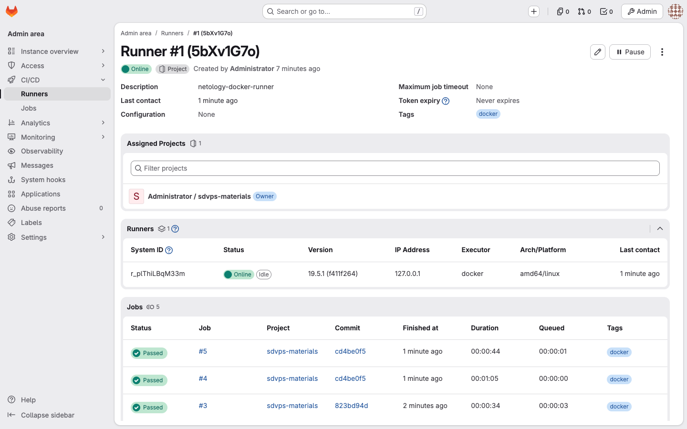
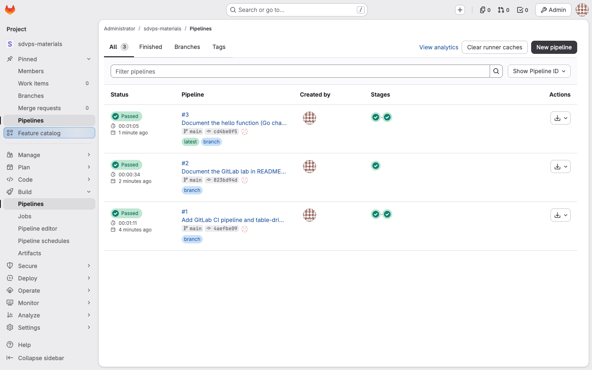
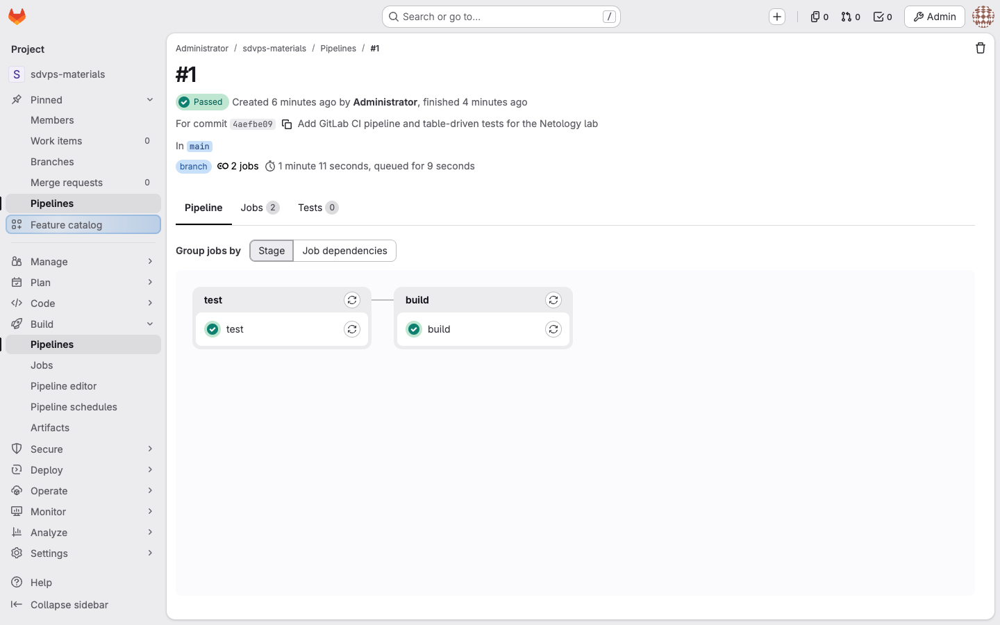
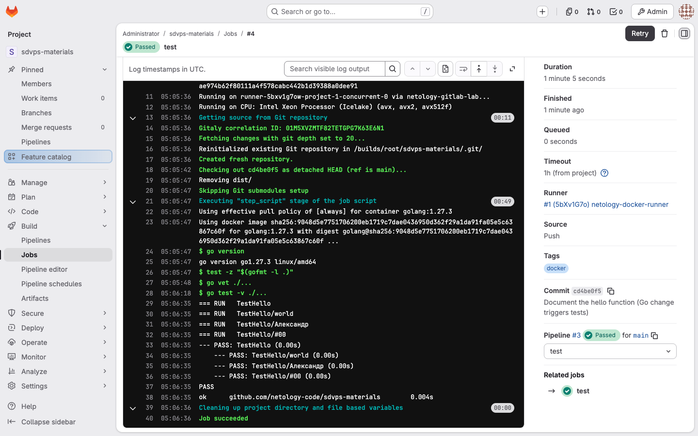
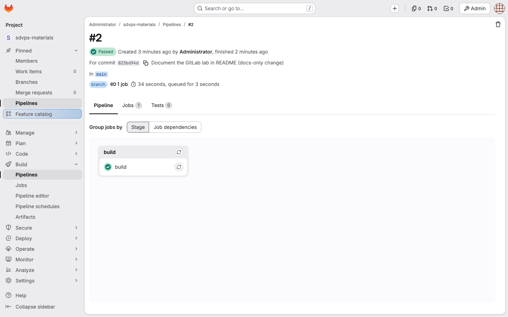
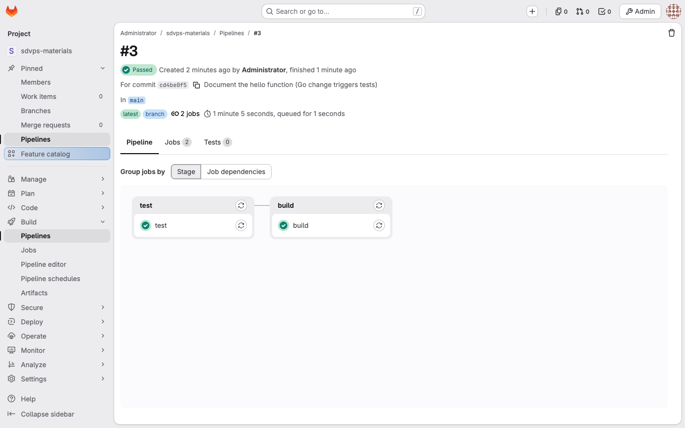

# Домашнее задание «GitLab» — Юклашов Александр

SYS-62, выполнено 27 октября 2026 года. **Статус: отправлено 27 октября 2026; кабинет показал «Задание принято» (самопроверка). Временный стенд и диск удалены.**

[Условие](Задание.md) · [История и следующий шаг](Мануал.md) · [Текстовые свидетельства стенда](evidence/gitlab-lab.txt)

Стенд: GitLab CE 19.5.1 (официальный пакет `gitlab-ce` для Ubuntu 24.04) на временной Linux VM в Yandex Cloud (2 vCPU / 8 GiB), созданной кодом ([infra/](infra/План_запуска.md)). Vagrantfile из учебного репозитория рассчитан на VirtualBox x86-64 с 6 ГБ RAM, что недоступно на ARM-ноутбуке с 8 ГБ, поэтому вместо VirtualBox использована облачная VM с тем же составом: GitLab в пакете omnibus, Docker и gitlab-runner на той же машине. Веб-интерфейс опубликован только на 127.0.0.1:18080 и открыт через SSH-туннель; снимки сделаны через этот туннель. Стенд одноразовый и удаляется после снятия свидетельств.

## Задание 1 — GitLab, проект и Docker Runner

1. GitLab развёрнут, в нём создан проект `root/sdvps-materials` с пустым репозиторием (без README при создании).
2. Для проекта зарегистрирован project runner `netology-docker-runner` с executor `docker`, тегом `docker`, образом по умолчанию `golang:1.27.3`, `concurrent = 2`, без `privileged` и без проброса Docker socket в job. Раннер работает в контейнере `gitlab/gitlab-runner:alpine` на той же VM, что и GitLab.

Настройки раннера в проекте (Settings → CI/CD → Runners):



Карточка раннера в админке: executor docker, платформа amd64/linux, версия 19.5.1, выполненные jobs:



Конфигурация раннера без токена (из `config.toml`):

```toml
concurrent = 2
  name = "netology-docker-runner"
  url = "http://127.0.0.1:18080"
  executor = "docker"
    image = "golang:1.27.3"
    memory = "2g"
    cpus = "1"
    privileged = false
    volumes = ["/cache"]
    network_mode = "host"
```

## Задание 2 — перенос репозитория и pipeline

Учебный репозиторий [netology-code/sdvps-materials](https://github.com/netology-code/sdvps-materials) (мой форк `yuklashov/sdvps-materials`) перенесён на GitLab в отдельной рабочей копии: прежний GitHub remote сохранён под именем `github`, а `origin` переназначен на проект GitLab.

```
$ git remote -v
github  https://github.com/yuklashov/sdvps-materials.git (fetch)
github  https://github.com/yuklashov/sdvps-materials.git (push)
origin  http://127.0.0.1:18080/root/sdvps-materials.git (fetch)
origin  http://127.0.0.1:18080/root/sdvps-materials.git (push)
$ git push -u origin main
 * [new branch]      main -> main
```

В репозиторий добавлены [.gitlab-ci.yml](.gitlab-ci.yml) и расширенный [main_test.go](main_test.go); [main.go](main.go) и [go.mod](go.mod) учебные.

```yaml
workflow:
  rules:
    - if: '$CI_PIPELINE_SOURCE == "push" && $CI_COMMIT_BRANCH'
    - when: never

stages:
  - test
  - build

default:
  image: golang:1.27.3
  tags:
    - docker
  before_script:
    - go version

test:
  stage: test
  rules:
    - changes:
        - '*.go'
        - '**/*.go'
    - when: never
  script:
    - test -z "$(gofmt -l .)"
    - go vet ./...
    - go test -v ./...

build:
  stage: build
  needs: []
  script:
    - mkdir -p dist
    - CGO_ENABLED=0 GOOS=linux go build -trimpath -o dist/hello .
    - test "$(dist/hello world)" = "Hello world!"
  artifacts:
    paths:
      - dist/hello
    expire_in: 7 days
```

Этапы: `test` проверяет форматирование (`gofmt`), выполняет `go vet` и `go test -v`; `build` собирает статический Linux-бинарник, проверяет его запуск и сохраняет `dist/hello` артефактом на 7 дней. Pipeline запускается только при push в ветку.

Все три pipeline успешны:



Pipeline #1 — первый push (код + CI): jobs `test` и `build`:



Журнал job `test`: образ `golang:1.27.3` в Docker executor, `go test` проходит:



## Задание 3* — сборка без ожидания тестов, тесты только при изменении *.go

Реализовано в том же `.gitlab-ci.yml`:

- `build` объявлена с `needs: []`, поэтому стартует сразу, не дожидаясь стадии `test`. В pipeline #1 job `test` началась в 05:01:55 UTC, `build` — в 05:01:56, обе выполнялись параллельно на двух слотах раннера (`concurrent = 2`); `build` завершилась раньше `test`.
- `test` ограничена `rules:changes` по шаблонам `*.go` и `**/*.go`; при отсутствии изменений в Go-файлах job не создаётся (`when: never`).

Проверка правил тремя push подряд:

| Pipeline | Изменение | Jobs | Результат |
|---|---|---|---|
| #1 | первый push ветки: go.mod, main.go, main_test.go, .gitlab-ci.yml | test, build | passed, 1:11 |
| #2 | только README.md | build | passed, 0:34 |
| #3 | комментарий в main.go | test, build | passed, 1:05 |

Pipeline #2 — изменение только README: тесты пропущены, выполнена только сборка:



Pipeline #3 — изменение main.go: тесты снова выполняются вместе со сборкой:



Для первого push новой ветки GitLab считает изменёнными все файлы, поэтому `test` выполняется и при начальном переносе. Tag, schedule, web и MR pipelines исключены через `workflow:rules`, так как для них сравнение изменений требует отдельной политики. Документация: [needs](https://docs.gitlab.com/ci/yaml/needs/), [rules:changes](https://docs.gitlab.com/ci/jobs/job_rules/).

Точные времена jobs, версии GitLab и раннера, фрагменты журналов — в [evidence/gitlab-lab.txt](evidence/gitlab-lab.txt). Токены, пароли и адреса стенда не публикуются.

## Завершение стенда

После проверки и сохранения всех доказательств временная VM и её загрузочный диск удалены. Отсутствие обоих ресурсов проверено через API Yandex Cloud: [подтверждение очистки](evidence/cleanup.txt). Для просмотра отчёта работающий GitLab не требуется.
